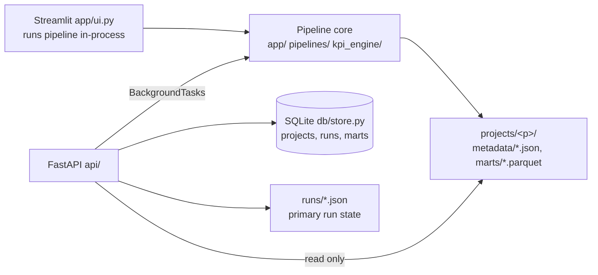
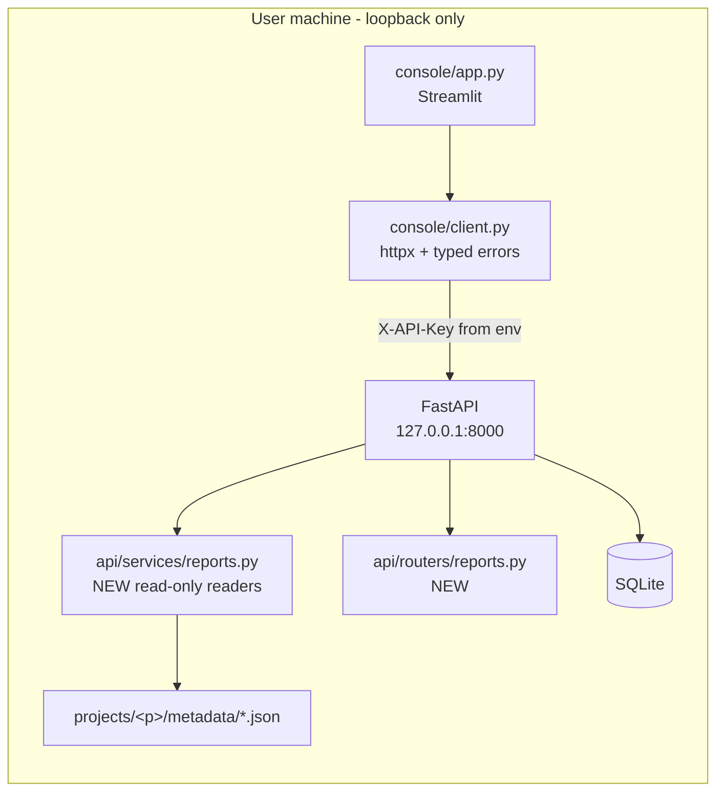
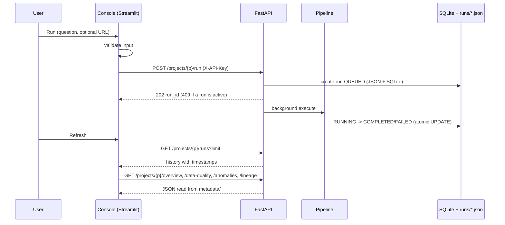
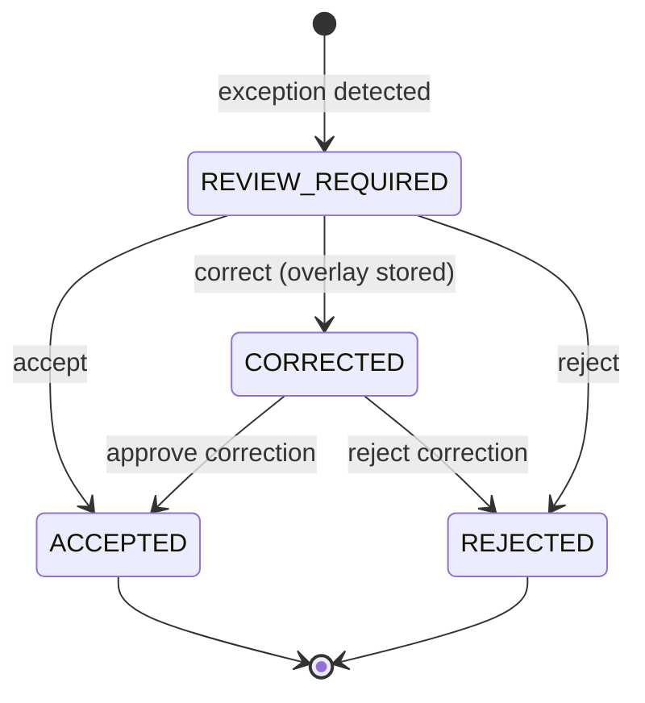

# Quaero Phase 3 - Operations Console

Status: **approved and implemented as the v0.6.0 candidate** (screens A-E and the four read endpoints);
the human review queue (screen F, section 8) remains **design only**. Date: 2026-10-27.
Baseline: `main` at v0.5.0 (`3de392e`), 284 tests, CI green.
Target release: **v0.6.0** (after the PR is merged and CI is green; no tag before the merge).

Decisions taken at approval: Streamlit console plus the four read endpoints; `127.0.0.1` in the API
documentation; `POST /projects/{p}/run` validates the project identifier (all existing project names
and the names used by the tests already comply, so no existing name is rejected); review rules and
reviewer identity are designed below and not implemented.

Legend used throughout: **IMPLEMENTED** / **PARTIAL** / **ABSENT** / **NOT VERIFIED**.

---

## 1. Executive summary

Quaero already has a pipeline, a REST API (8 endpoints) and a SQLite run history. What is missing for an
operations console is not a frontend technology but a handful of **read endpoints** (data quality,
anomalies, lineage, project overview), because those artifacts exist on disk but are not exposed.

**Recommendation: a local Streamlit console (`console/`) that is a thin HTTP client of the existing
FastAPI, not Retool.**

| Question | Answer |
|---|---|
| Can Retool Free deliver a working MVP at EUR 0 with no public exposure? | **No.** Retool is cloud-only on Free; its servers call the REST API, so a backend on `localhost` is unreachable without a public tunnel. Self-hosting is Enterprise-only. |
| What is the simplest complete demo at EUR 0? | Streamlit (already a dependency) + the local FastAPI. Everything runs on the user's machine. |
| Does this lock out Retool later? | No. The console talks to the API only, so the API gaps closed for it are the same ones a Retool/other frontend would need. |

Scope of the MVP: Project Explorer, Pipeline Operations (+ run history), Mart Explorer, Data Quality &
Anomalies, Lineage Viewer. Human review is **designed here, not built**.

New backend surface (4 read-only GET endpoints, no schema change to existing ones):
`/projects/{p}/overview`, `/projects/{p}/data-quality`, `/projects/{p}/anomalies`, `/projects/{p}/lineage`.

---

## 2. Current architecture (evidence from the code)



### 2.1 Capability inventory

| Capability | Status | Evidence |
|---|---|---|
| Project listing (`name`, `marts_count`, `has_summary`) | IMPLEMENTED | `GET /projects` |
| Final summary report | IMPLEMENTED | `GET /projects/{p}/summary` returns the raw JSON |
| Mart list | IMPLEMENTED | `GET /projects/{p}/marts` -> `{name, path}` |
| Mart preview, paginated | IMPLEMENTED | `GET .../marts/{mart}?page&page_size<=1000` -> `columns, rows, total_rows` |
| Mart filtering / sorting / dtypes | ABSENT | preview supports pagination only; dtypes are not returned |
| Trigger run | IMPLEMENTED | `POST /projects/{p}/run` (202; 409 if QUEUED/RUNNING; SSRF check) |
| Run status | PARTIAL | `GET .../runs/{id}` returns `status, error, result_keys` but **no timestamps** |
| Run history | IMPLEMENTED | `GET /projects/{p}/runs?limit` (SQLite, 503 on DB error, `total` = all runs) |
| Last run per project, in one call | ABSENT | would need N+1 calls to `/runs?limit=1` |
| Data Quality score report | PARTIAL | `dq_score_<source>.json` written by `pipelines/dq_scorer.py`; **no endpoint** |
| Anomaly report (v1 / v2 framed) | PARTIAL | `anomaly_report[_v2]_<source>.json` written; **no endpoint** (only a path inside `summary`) |
| Lineage graph | PARTIAL | `metadata/lineage.json` + `lineage.html` written; **no endpoint** |
| Metrics definitions, cleaning summary, profile, dashboard suggestions | PARTIAL | files exist; no endpoint (deferred) |
| Auth | IMPLEMENTED | single shared `X-API-Key`, fail-closed 503 |
| Human review, approval, audit trail | ABSENT | no tables, no endpoints, no UI |
| Per-user identity / roles | ABSENT | one shared key |
| Run cancellation / retry | ABSENT | |
| Existing Streamlit UI | IMPLEMENTED | `app/ui.py` launches runs in-process; unrelated to the API; to be preserved |

### 2.2 Findings that change the design

1. **DQ, lineage and anomaly framing v2 exist only for single-dataset runs.** In
   `app/pipeline_runner.py`, `score_dataframe`, `build_lineage`, `render_lineage_html` and
   `frame_anomalies` are called inside `run_pipeline`; `run_project_from_config` (multi-dataset) only calls
   `detect_anomalies` (v1). The console must therefore treat "artifact not generated" as a normal state,
   not an error (HTTP 404 with a clear message, rendered as an info box).
2. **These artifacts are git-ignored** (`projects/*/metadata/dq_score_*`, `anomaly_report_*`, ...). The two
   committed demo projects contain only `final_summary_report.json` and `metrics_definitions.json`.
   A demo requires running a pipeline first; tests must generate artifacts with the real writers.
3. **The summary schema drifts across versions.** `release_impact` (older) has no `anomaly_report_v2_path`
   or `lineage_html_path`; the writer in the current code emits both. The API must locate artifacts by
   file-name convention inside `metadata/`, not trust paths in the summary.
4. **`lineage.html` loads Mermaid from a public CDN** (`cdn.jsdelivr.net`). Serving or embedding it would
   execute remote script. The console will not render that HTML; it renders `lineage.json` instead.
5. **`api/README.md` suggests `uvicorn ... --host 0.0.0.0`**, which exposes the API on the LAN. The console
   documentation will use `127.0.0.1`.
6. **`POST /projects/{p}/run` does not validate the project identifier** (reads and mart endpoints do).
   Impact is low (the pipeline normalizes names), but changing it would reject names previously accepted.
   Left as is; flagged for a decision (section 15).

---

## 3. Frontend decision

### 3.1 Retool Free - findings

Sources: Retool pricing and documentation pages fetched 2026-10-27. Items marked **NOT VERIFIED** could not
be confirmed from an official page (several documentation URLs returned 404).

| Topic | Finding | Status |
|---|---|---|
| Free plan | Up to 5 users, unlimited web apps, 500 workflow runs/month, production environment only | VERIFIED (retool.com/pricing) |
| Hosting | Free is Retool Cloud only | VERIFIED (retool.com/pricing) |
| Self-hosted | Enterprise plan only; needs a license key checked daily | VERIFIED (pricing, docs.retool.com/self-hosted) |
| Git source control, audit logs, granular roles, SSO | Enterprise / Business only | VERIFIED (pricing) |
| REST resource | Available; global custom headers (e.g. `X-API-Key`), query params, JSON body | VERIFIED (docs.retool.com REST pages) |
| Periodic refresh (polling) | "Run this query periodically" exists; plan gating unknown | VERIFIED exists / NOT VERIFIED for Free |
| Cloud reaching `localhost` | Queries are executed by Retool's servers; resources must allow Retool's IPs. `localhost` is unreachable | VERIFIED (IP allowlist docs) + community confirmation |
| SSH tunnel | Documented for databases only, not REST APIs | VERIFIED (docs) |
| Table / Form / Modal / Chart / IFrame components on Free | NOT VERIFIED (component docs not retrievable) | NOT VERIFIED |
| Server-side pagination of Table | NOT VERIFIED | NOT VERIFIED |
| App export (JSON) on Free; lock-in | Export exists; apps are Retool-specific; resources are not exported; Free availability unverified | PARTIAL |
| Free-plan permission model, query timeouts, data-volume limits | NOT VERIFIED | NOT VERIFIED |

Conclusion: with the backend on `localhost`, Retool Free cannot work without exposing the FastAPI to the
internet through a tunnel (ngrok/cloudflared-style; third-party, **NOT VERIFIED** as free for this use). That
conflicts with the constraint "do not expose FastAPI publicly", so no silent workaround is adopted.

### 3.2 Comparison

| Criterion | A. Streamlit evolved (**chosen**) | B. Retool Cloud Free | C. Retool self-hosted | D. Custom frontend (Google AI Studio export) |
|---|---|---|---|---|
| Real extra cost | EUR 0 | EUR 0 + needs a public tunnel/host | Enterprise licence (not EUR 0) | EUR 0 to build; hosting needed unless run locally |
| Reaches local FastAPI | Yes (server-side Python, loopback) | **No** without public exposure | Yes (own network) | Only if served locally; a hosted preview cannot reach `localhost` (reasoning, NOT VERIFIED against AI Studio docs) |
| Setup | `streamlit run` (already installed) | Account + resource + tunnel | Docker, Postgres, licence | New project, build tooling, CORS |
| Credentials | Env var read server-side, never in browser | Stored in Retool resource | Same | API key would live in browser JS unless a proxy is added |
| Security posture | Loopback only | Public endpoint + shared key | Private | Public or local; key exposure risk |
| Testability in CI | `AppTest` + mocked HTTP (already used in `tests/test_ui.py`) | Not testable in repo CI | Not testable in repo CI | Needs a JS test stack |
| Portability / lock-in | Plain Python, in repo | Retool-specific app | Retool-specific | Code exportable, but a second stack to maintain |
| Maintenance | One language, one repo | External SaaS UI | Ops burden | Two stacks |
| Portfolio value | Runs from the repo; reviewable code and tests | Screenshots only | n/a | Good visually, heavier |

Decision: **A**. Only one frontend is built. Retool stays a documented future option because the same four
endpoints serve it.

---

## 4. Components



| Component | Responsibility | New / existing |
|---|---|---|
| `console/app.py` | Streamlit pages (tabs), session state, no business logic | new |
| `console/client.py` | One method per endpoint, timeouts, maps HTTP errors to typed exceptions | new |
| `console/formatting.py` | Pure functions: run duration, status labels, lineage -> Graphviz DOT, DQ/anomaly -> DataFrame, form validation | new |
| `api/routers/reports.py` | 4 GET endpoints behind the existing `require_api_key` | new |
| `api/services/reports.py` | Locate and parse artifacts safely (identifier validation, `resolve()` + `is_relative_to`, size cap) | new |
| `api/schemas.py` | Response models for the four endpoints | extended (additive) |
| Pipeline core, SQLite store, existing endpoints | unchanged | existing |

---

## 5. API gap analysis

New endpoints (all `GET`, auth via existing dependency, project identifier validated like marts):

| Endpoint | Source artifact | Response (summary) | 404 when |
|---|---|---|---|
| `/projects/{p}/overview` | summary + metadata listing + SQLite | `project`, `project_mode`, `question`, `primary_mart`, `primary_kpi`, `marts_count`, `has_config`, `artifacts{summary,data_quality,anomalies,lineage,metrics_definitions}`, `last_run`, `history_available` | project missing |
| `/projects/{p}/data-quality` | `dq_score_*.json` | `reports[]` -> `source, generated_at, overall_score, column_count, columns[{column,dtype,completeness,uniqueness,outlier_flag,format_score,dq_score}]` | no DQ artifact |
| `/projects/{p}/anomalies` | `anomaly_report_v2_*.json`, else `anomaly_report_*.json` | `version` (`v1`/`v2`), `anomaly_row_count`, `business_summary?`, `anomalies[{column,method,threshold,anomaly_count,example_values,frequency?,impact?,suggested_action?}]` | no report |
| `/projects/{p}/lineage` | `lineage.json` | `source, generated_at, node_count, edge_count, nodes[], edges[{from,to,type}]` | no lineage |

Field names are taken from the real writers (`dq_scorer.py`, `anomaly_detection.py`,
`anomaly_framing.py`, `lineage.py`). `v2`-only fields are optional so v1 reports validate.

Per-screen matrix:

| Screen / UI component | Endpoint | Exists | Payload sufficient | Missing | Backend change | Priority | Complexity |
|---|---|---|---|---|---|---|---|
| Explorer: project list | `GET /projects` | yes | name, marts_count, has_summary | last run, status | use `overview` per project | P0 | S |
| Explorer: detail + last run | `GET /projects/{p}/overview` | **no** | - | whole endpoint | new | P0 | M |
| Operations: start run form | `POST /projects/{p}/run` | yes | yes | `has_config` to validate input | `overview.has_config` | P0 | S |
| Operations: run status | `GET .../runs/{id}` | yes | status, error | timestamps | none: use history item (has timestamps) | P0 | S |
| Operations: history table | `GET .../runs?limit` | yes | yes, with `total` | - | none | P0 | S |
| Mart Explorer: list | `GET .../marts` | yes | name, path | - | none | P0 | S |
| Mart Explorer: preview + paging | `GET .../marts/{m}` | yes | columns, rows, total_rows | dtypes, filters, sort | none for MVP; filter applies to the current page only and is labelled as such | P0 | S |
| DQ tab | `GET .../data-quality` | **no** | - | endpoint | new | P1 | M |
| Anomalies tab | `GET .../anomalies` | **no** | - | endpoint | new | P1 | M |
| Lineage tab | `GET .../lineage` | **no** | - | endpoint | new | P1 | M |
| Metrics definitions, cleaning summary | - | no | - | endpoints | deferred | P3 | M |
| Review queue | - | no | - | tables + endpoints | deferred (section 8) | P2 | L |

---

## 6. Screens (MVP)

All screens live in one Streamlit app with a project selector in the sidebar and tabs.

**A. Project Explorer**
Table of projects (`name`, mode, marts, last run status/time) from `overview`. Selecting a project shows
its question, primary mart/KPI and a row of artifact badges (summary, DQ, anomalies, lineage). Missing
artifacts are shown as "not generated for this project", not as errors.

**B. Pipeline Operations**
Form: question (1-1000 chars), optional source URL (http/https). Client-side validation mirrors the API; if
the project has no `project_config.json`, a source URL is required. The Run button is disabled while the
latest run is QUEUED/RUNNING; a 409 from the API is shown as a message. Status panel with a manual
"Refresh" (optional auto-refresh only while a run is active, so no polling loop otherwise). History table:
status, created, started, completed, duration (computed from timestamps), error. If history returns 503
the screen says the history store is unavailable instead of showing an empty table.

**C. Data Quality & Anomalies**
DQ: overall score, per-column table of the real dimensions (completeness, uniqueness, format score,
outlier flag, dq_score). The weights are documented in the scorer; the console shows them as-is and adds no
pass/fail threshold. Anomalies: `business_summary`, table with column, method, threshold, count,
frequency, impact and suggested action (v2) or the v1 subset, plus example values.

**D. Mart Explorer**
Mart selector, metadata (`total_rows`, `columns`), paginated table (page, page size), and a text filter that
only filters the rows already loaded and says so. CSV download of the current page.

**E. Lineage Viewer**
Counts, a Graphviz graph built from `lineage.json` (`st.graphviz_chart`, no external script) with
colour by layer (raw / staging / mart), a node table and an edge table filterable by edge type. Labels are
passed through an escaping function; the pipeline's `lineage.html` is not rendered.

**F. Human Review Queue** - deferred; see section 8. The console shows no review controls in v0.6.0.

---

## 7. Data flow



---

## 8. Human review - design only (not implemented)

Principle: **pipeline run status** (`QUEUED/RUNNING/COMPLETED/FAILED`, already implemented) and **review
status** of a result are different things and live in different tables. Original artifacts are never edited.



Detection (what creates a `REVIEW_REQUIRED` item) must be a **rule on existing fields**, for example
anomaly `impact` in {`high`,`medium`} (v2) or a DQ column with `outlier_flag = true`. The thresholds are a
policy choice for the owner; **no confidence score is introduced**.

Candidate tables (additive migration, schema version 2):

| Table | Purpose | Key columns |
|---|---|---|
| `review_items` | one row per item needing review | `id`, `project`, `run_id`, `kind` (`anomaly`/`dq`), `ref` (column/anomaly key), `status`, `created_at`, `updated_at` |
| `review_events` | **append-only** audit trail | `id`, `item_id`, `from_status`, `to_status`, `reviewer`, `reason`, `at` |
| `review_corrections` | corrections as an overlay, never a patch on the artifact | `id`, `item_id`, `payload_json`, `created_at` |

Rules: transitions are one conditional `UPDATE ... WHERE status IN (allowed)` with a `rowcount` check
(same pattern as `transition_run`); a reason is mandatory for `CORRECTED` and `REJECTED`; events are never
updated or deleted.

Candidate endpoints: `GET /review/items?status=&project=`, `GET /review/items/{id}`,
`POST /review/items/{id}/decision` (`{decision, reason, correction?}`), `GET /review/items/{id}/events`.

Authorization limit to resolve first: there is **one shared API key**, so `reviewer` would be a
self-declared string and the audit trail would not be attributable. Real attribution needs per-user
identity (out of scope for a single-user local tool); until then the field must be labelled "declared
reviewer".

### 8.1 Rules that generate `REVIEW_REQUIRED` (proposal, to be approved)

Rules read fields that already exist in the artifacts; none uses a score that the pipeline does not
produce. An item is identified by `(project, run_id, kind, ref)` so re-detection of the same run is
idempotent.

| Rule | Reads | Creates an item when | Notes |
|---|---|---|---|
| R1 | anomaly report v2 `anomalies[].impact` | `impact = "high"` | `ref` = column; default-on |
| R2 | anomaly report v2 `anomalies[].impact` | `impact = "medium"` | default-off; owner decides |
| R3 | DQ report `columns[].outlier_flag` | `outlier_flag = true` | `ref` = column |
| R4 | DQ report `columns[].completeness` / `dq_score` | below an **owner-defined** threshold | no default threshold is shipped |
| R5 | run `status` | `FAILED` | `kind = run`; links to the error already stored |

v1-only anomaly reports have no `impact`, so they generate no items (the console shows them as raw
detections). Thresholds, and which rules are enabled, live in a small config file owned by the user,
not in code.

### 8.2 Reviewer identification (options)

| Option | Attribution | Cost / effort | Verdict |
|---|---|---|---|
| a. Declared string typed in the console | none (self-asserted) | trivial | interim only, stored with `reviewer_source = "declared"` |
| b. OS user captured by the local console | weak (local account name) | small | acceptable for a single-machine demo |
| c. Per-reviewer API keys mapped to a reviewer id (hashes stored, never the keys) | real, per key | medium | recommended before any shared use |

Whatever the option, the server (not the console) writes the reviewer into `review_events`, together
with `reviewer_source`.

### 8.3 Corrections without altering artifacts

Original artifacts (`metadata/*.json`, Parquet marts) are read-only inputs. A correction is a row in
`review_corrections` holding a structured overlay (for example `{"field": "impact", "from": "high",
"to": "low", "justification": "..."}`) tied to the item and the run. Consumers that want the
"effective" view apply the latest accepted overlay on top of the artifact at read time; the artifact
file on disk, and therefore its lineage and reproducibility, never change. Rejected or superseded
overlays stay in the table for audit.

---

## 9. Security

| Concern | Decision |
|---|---|
| Exposure | API and console bind to `127.0.0.1`; no tunnel, no public URL. Docs corrected from `0.0.0.0` |
| Credentials | `QUAERO_API_KEY` / `QUAERO_API_URL` from environment; never in repo, never in browser JS; Streamlit calls the API server-side |
| Auth on new endpoints | existing `require_api_key` (401 / fail-closed 503) |
| Path traversal | identifier allowlist `[A-Za-z0-9_-]`, `resolve()` + `is_relative_to()`, artifact files must resolve inside `metadata/` |
| Untrusted content | artifacts rendered as data (tables, escaped Graphviz labels); no HTML from artifacts is rendered; `lineage.html` (CDN script) is not used |
| Resource limits | artifact size cap (10 MB); mart page size already capped at 1000 |
| Error handling | corrupt artifact -> 500 with generic detail; DB failure -> 503; absent artifact -> 404; no tracebacks |
| AI | no AI calls added; nothing paid is triggered |

---

## 10. Costs

| Item | Monthly |
|---|---|
| Streamlit (open source, already a dependency), httpx (already a dependency) | EUR 0 |
| FastAPI, SQLite | EUR 0 |
| Hosting | EUR 0 (runs locally) |
| Retool Free | EUR 0 but requires a public tunnel to reach `localhost` (rejected) |
| Retool self-hosted | Enterprise licence (not EUR 0; rejected) |

New runtime dependencies: **none**.

---

## 11. Deployment

Local only. Two processes on the same machine:

```bash
export QUAERO_API_KEY="your-secret-key"
uvicorn api.main:app --host 127.0.0.1 --port 8000
streamlit run console/app.py        # reads QUAERO_API_URL (default http://127.0.0.1:8000) and QUAERO_API_KEY
```

No Docker, no cloud, no deployment automation in this phase. `app/ui.py` stays untouched.

---

## 12. MVP scope and deferrals

In scope (v0.6.0): screens A-E, the four read endpoints, tests, docs, changelog.

Deferred, with reason:

| Item | Reason |
|---|---|
| Human review queue (F) and any persistence of decisions | needs the data model and workflow above and a decision on reviewer identity |
| Server-side mart filtering / sorting, dtype metadata | backend change not needed for the demo; filter is page-local and labelled |
| Metrics definitions, cleaning summary, profile, dashboard suggestions screens | no endpoint yet; not required by the MVP |
| Run cancel / retry | no backend support |
| DQ/lineage for multi-dataset projects | the pipeline does not generate them (finding 1); would be a pipeline change |
| Serving `lineage.html` | CDN script; would need a CSP/sandbox decision |
| Retool app | blocked by connectivity; revisit only with an approved hosting plan |

---

## 13. Testing strategy

| Layer | Approach |
|---|---|
| New endpoints | FastAPI `TestClient` as in `tests/test_api.py`; fixtures generated by the **real writers** (`score_dataframe`, `detect_anomalies`, `frame_anomalies`, `build_lineage`) into a temp project, so schemas cannot drift |
| Auth | 401 wrong key, 503 unset key, 200 correct key, for each new route |
| Validation / traversal | identifiers with `..`, `/`, spaces; symlink/escape attempts; missing project |
| Artifact states | missing (404), corrupt JSON (500), v1-only anomalies, multi-dataset project without DQ/lineage, oversized artifact |
| Overview | last run present / absent / SQLite failure (`history_available = false`) |
| Console client | `httpx.MockTransport`: success, 401, 404, 409, 503, timeout -> typed errors |
| Console formatting | pure-function unit tests (duration, DOT escaping, form validation) |
| Console UI | Streamlit `AppTest` with a stubbed client: renders each tab, disables Run while a run is active, shows 503 as "unavailable" |
| Regression | full `pytest`, `ruff format --check`, `ruff check`, `compileall` (CI parity) |

---

## 14. Acceptance criteria

1. With the API and console running locally, a user can list projects, see the last run, start a run,
   see its status change to a terminal state, and see it in the history with duration, without a duplicate
   job being created.
2. A project's marts can be listed and paged; the page-local filter is labelled as such.
3. DQ, anomaly and lineage tabs show real artifact data; a project without them shows "not generated",
   not an error; a SQLite outage is shown as "unavailable", not as empty.
4. No credential appears in the repository or the browser; the API is reachable only on loopback.
5. All new endpoints require the API key; traversal attempts are rejected.
6. No change to existing endpoint contracts or to the pipeline core; `app/ui.py` unchanged.
7. Tests, Ruff and `compileall` pass; CI green on the PR.
8. Release v0.6.0 only after merge to `main` with CI green, an annotated tag, a changelog entry and
   updated docs; existing tags are never moved.

---

## 15. Risks, limitations, decisions requiring approval

Risks / limitations
- Two processes must be started by the user; there is no packaged launcher.
- Streamlit reruns the script per interaction; auto-refresh is limited to active runs to avoid a polling loop.
- Page-local mart filtering can mislead; it is labelled, and server-side filtering is deferred.
- The shared API key cannot attribute review decisions to individuals.
- Retool and AI Studio findings marked NOT VERIFIED may change if their documentation becomes available.
- DQ and lineage are absent for multi-dataset projects until the pipeline changes.

Decisions for the owner
1. Approve **Streamlit console + four read endpoints** as the Phase 3 scope (rejecting Retool Free for now).
2. Approve fixing `api/README.md` to use `127.0.0.1` (documentation only).
3. Decide whether `POST /projects/{p}/run` should validate the project identifier (security hardening,
   but rejects names accepted today).
4. Decide the review-trigger rules and the reviewer-identity model before Phase 4/5 work on the queue.

---

## 16. Roadmap

| Step | Deliverable | Gate |
|---|---|---|
| 1 | Owner approval of this document | decisions in section 15 |
| 2 | `api/services/reports.py`, router, schemas + tests | tests green |
| 3 | `console/client.py`, `formatting.py` + tests | tests green |
| 4 | `console/app.py` screens A-E + `AppTest` tests | tests green |
| 5 | Docs (README, API README, console usage), CHANGELOG `Unreleased` | review |
| 6 | PR to `main`, CI green, merge | owner approval |
| 7 | Tag `v0.6.0`, GitHub Release with changelog notes | only after step 6 |
| Later | Review queue (data model + endpoints + screen F) | separate phase |
